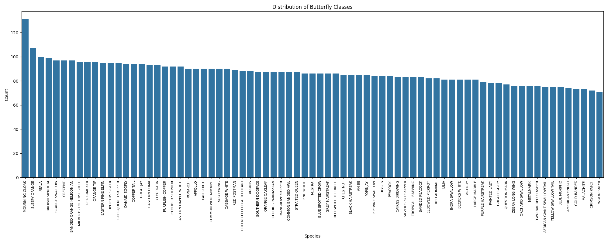

# Butterfly Species Classification

A PyTorch image classification project for 75 butterfly species. It includes dataset exploration, a ResNet50 inference checkpoint, batch test predictions, and a Streamlit image upload interface.

## What is included

- `eda.py` creates class distribution and sample image charts.
- `dataset.py` reads image filenames and labels and applies image preprocessing and training augmentation (crop, horizontal flip, rotation, ImageNet normalization).
- `predict.py` loads the trained ResNet50 checkpoint and writes test predictions to `submission.csv`.
- `app.py` displays the predicted species, confidence, and top three class probabilities for an uploaded image.
- `butterfly_resnet50.pth` is the supplied model checkpoint.




## Dataset and setup

Download the [Butterfly Image Classification dataset](https://www.kaggle.com/datasets/phucthaiv02/butterflyimage-classification). Put `Training_set.csv` and `Testing_set.csv` beside the scripts, with image folders named `train/` and `test/`. The CSV files and image folders are required at runtime and are not included in this file set.

```text
project/
  README.md
  requirements.txt
  app.py
  dataset.py
  eda.py
  predict.py
  butterfly_resnet50.pth
  Training_set.csv
  Testing_set.csv
  train/
  test/
```

Create a virtual environment and install dependencies:

```bash
python -m venv .venv
# Windows PowerShell:
.venv\Scripts\Activate.ps1
pip install -r requirements.txt
```

Run exploration, predictions, or the web app from the project directory:

```bash
python eda.py
python predict.py
streamlit run app.py
```

The checkpoint needs class names from `Training_set.csv`, including when running the web app. The code maps class names in sorted order. Keep the same training labels used for the checkpoint. `predict.py` writes `submission.csv` with `filename` and `label` columns.

## Model and scope

The inference scripts reconstruct a ResNet50 model with a classification layer sized to the training labels. Image inputs are resized to 256 pixels, cropped to 224 pixels, and normalized with ImageNet statistics. The provided files do not include `train.py`, training curves, measured accuracy, or a comparison of multiple architectures; the accompanying PDF describes those as project objectives, not verified outcomes.

## Publishing on GitHub

GitHub blocks regular Git files over 100 MB. Check the model size on your own machine before pushing. If the checkpoint exceeds the limit, use Git LFS (`git lfs track "*.pth"`) before `git add`. Keep the full image dataset outside Git unless its license and size make publishing appropriate. Add `.venv/`, `train/`, and `test/` to `.gitignore`. Do not publish any private data or credentials.
