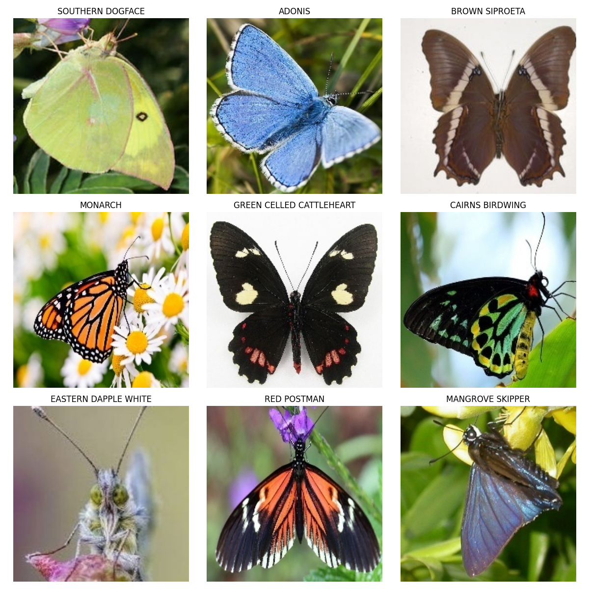
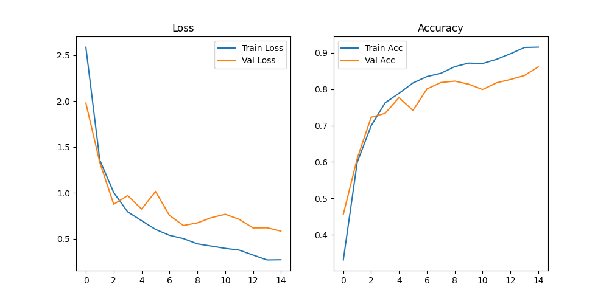

# Butterfly Species Classification

A PyTorch image classification project for 75 butterfly species. It includes dataset exploration, ResNet50 training with ImageNet pretrained weights, batch test predictions, and a Streamlit image upload interface.

## What is included

- `eda.py` creates class distribution and sample image charts.
- `dataset.py` reads image filenames and labels and applies image preprocessing and training augmentation (crop, horizontal flip, rotation, ImageNet normalization).
- `train.py` trains ResNet50 and saves the checkpoint with the best validation accuracy.
- `predict.py` loads the trained ResNet50 checkpoint and writes test predictions to `submission.csv`.
- `app.py` displays the predicted species, confidence, and top three class probabilities for an uploaded image.
- `butterfly_resnet50.pth` is the supplied model checkpoint.
- `training_curves.png` shows training and validation loss and accuracy by epoch.





## Dataset and setup

Download the [Butterfly Image Classification dataset](https://www.kaggle.com/datasets/phucthaiv02/butterflyimage-classification). Put `Training_set.csv` and `Testing_set.csv` beside the scripts, with image folders named `train/` and `test/`. The CSV files and image folders are required at runtime and are not included in this file set.

```text
project/
  README.md
  requirements.txt
  app.py
  dataset.py
  eda.py
  train.py
  predict.py
  butterfly_resnet50.pth
  eda_class_distribution.png
  eda_sample_images.png
  training_curves.png
  Training_set.csv
  Testing_set.csv
  train/
  test/
```

Create a virtual environment and install dependencies:

```bash
python -m venv .venv
# Windows PowerShell:
.venv\Scripts\Activate.ps1
pip install -r requirements.txt
```

Run exploration, training, predictions, or the web app from the project directory:

```bash
python eda.py
python train.py
python predict.py
streamlit run app.py
```

The checkpoint needs class names from `Training_set.csv`, including when running the web app. The code maps class names in sorted order. Keep the same training labels used for the checkpoint. `predict.py` writes `submission.csv` with `filename` and `label` columns.

## Training and model details

`train.py` uses an 80/20 random training and validation split (`random_state=42`), 15 epochs, batch size 32, Adam with learning rate 0.001, and cross entropy loss. It loads ImageNet pretrained ResNet50 weights, replaces the classifier for the dataset classes, and updates all model parameters. `FAST_MODE = True` runs one epoch on up to 200 images for a quick check. The script saves the best validation checkpoint to `butterfly_resnet50.pth` and writes `training_curves.png`.

Images are resized to 256 pixels, cropped to 224 pixels, and normalized with ImageNet statistics. Training additionally applies random horizontal flipping and rotation. The split is random, not stratified. This repository demonstrates one architecture; the accompanying project brief proposes comparison with other models, but no such comparison is claimed here. Check `train.log` or the training plot before reporting a numeric validation accuracy.

## Publishing on GitHub

The checkpoint is about 91 MB and was uploaded with the repository; GitHub warned that it exceeds its recommended 50 MB file size. Keep the full image dataset outside Git unless its license and size make publishing appropriate. Add `.venv/`, `train/`, and `test/` to `.gitignore`. Do not publish private data or credentials.
